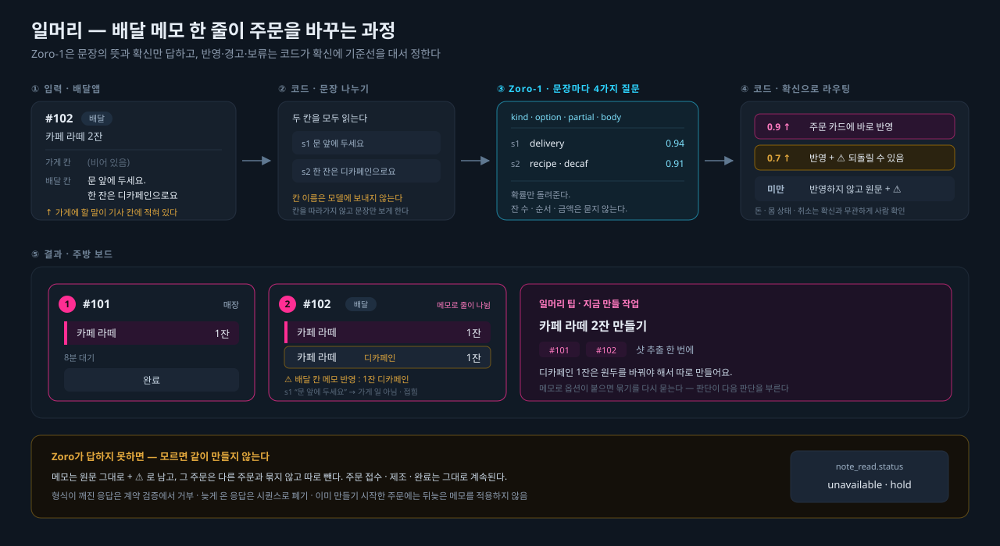

# 일머리

**바로 써 보기 → [teamktb.fly.dev](https://teamktb.fly.dev/)** · [키오스크](https://teamktb.fly.dev/kiosk)에서 주문하면 [주방 보드](https://teamktb.fly.dev/)가 실시간으로 바뀝니다.

- [사용자 시나리오](./scenarios.md) · [메뉴·AI 계약 데이터](./data/cafe_db.json)
- [실패 모드 분석](./docs/error-resilience.md) · [aiserver API](./docs/aiserver-api.md)

카페 주문과 다음 제조 작업을 보여주는 주방 운영 보드입니다. 배달 주문의 요청사항을 판단 모델 **Zoro-1**이 문장 단위로 읽어 주문 카드에 반영하고, 같이 만들 주문을 묶어 줍니다.



## 어떤 문제를 푸는가

**배달 주문의 요청사항은 적힌 칸을 믿을 수 없습니다.** 손님은 가게에 할 말을 배달기사 칸에 쓰고, 기사에게 할 말을 가게 칸에 씁니다. 바쁜 시간에 알바가 이걸 놓치면 그대로 재제조·환불·별점으로 돌아옵니다.

일머리는 **두 칸을 모두 읽되 칸 이름은 모델에게 알려주지 않습니다.** 문장만 보고 "이게 음료를 바꾸라는 말인지, 포장 요청인지, 기사에게 할 말인지"를 판단하게 합니다. 그래서 `#102`의 배달기사 칸에 숨어 있던 "한 잔은 디카페인으로요"를 찾아 **2잔 중 1잔만 디카페인으로 나누고, 그 잔만 따로 만들라고** 알려 줍니다.

### 왜 지금 가능한가


|               |                                                                                                          |
| ------------- | -------------------------------------------------------------------------------------------------------- |
| **경량 판단 모델**  | Zoro-1은 4B급이라 매장 단위로 돌릴 수 있습니다. 문장마다 확률을 돌려주므로 **자동으로 할 일과 사람에게 넘길 일을 가를 수 있습니다** — 생성형 모델로는 이 구분이 어렵습니다 |
| **교체가 필요 없음** | 쓰던 키오스크와 주방 화면은 그대로 두고 그 사이에서 판단만 합니다. 매장이 새로 사야 할 장비가 없습니다                                              |
| **한 화면에서 끝남** | 주문 보드 · 지금 만들 작업 · 재고 알림이 한 화면에 있습니다. 알바는 음료만 만들고, 메모 해석·묶어 만들기·재고 경고는 화면이 합니다                           |


메모를 직접 받으려면 배달앱 연동이 필요해, 실제 매장 적용은 **POS·KDS 벤더를 통한 모듈 납품**을 전제로 합니다. 이 저장소의 키오스크·배달앱 화면은 그 연동을 대신하는 목업입니다.

## 무엇이 동작하는가

메모 한 줄이 **주문을 바꾸고 → 제조 묶음을 다시 계산하고 → 그 이유를 설명하는** 데까지 이어집니다.

1. **메모 읽기** — 두 칸의 메모를 문장으로 나눠 문장마다 Zoro에 묻고, 확신만큼 주문 카드에 반영합니다
2. **묶기 재계산** — 메모로 옵션이 붙으면 묶기를 다시 묻습니다. 디카페인이 붙은 잔은 원두를 바꿔야 해서 자동으로 묶음에서 빠집니다
3. **설명** — 아래 카드가 어느 잔을 왜 따로 만드는지 적습니다

화면 세 개(주방 보드·키오스크·배달앱)가 같은 주문 저장소를 보고 SSE로 실시간 갱신됩니다. 시연 장면은 보드 상단에서 바로 재생할 수 있습니다(아래 [시나리오](#시나리오)).

```sh
npm ci && npm test     # 보드 118건 · 메모 판단과 폴백 경로 포함
```

`tests/note.test.ts`가 확신 임계값 동작을, `tests/order-store.test.ts`가 폴백 경로를 검증합니다. aiserver는 `uv run pytest -q`(41건).

에이전트가 실제로 판단한 기록은 시나리오를 재생해 파일로 뽑을 수 있습니다.

```sh
node scripts/capture-agent-logs.mjs --scenario SC-N --out logs/01-note-normal.log
```

## 오류가 나도 멈추지 않는다

모델이 답하지 못해도 주문은 계속 받고 계속 만듭니다. 실패 종류를 넷으로 나눠 **다르게** 처리합니다(`NoteRead.status`).


| status        | 언제                      | 동작                  |
| ------------- | ----------------------- | ------------------- |
| `checking`    | 답을 기다리는 중               | 아직 아무것도 반영하지 않음     |
| `ready`       | 정상                      | 확신만큼 반영             |
| `unavailable` | 읽지 못함(연결 실패·타임아웃·형식 오류) | 원문 + ⚠, **묶기에서 보류** |
| `off`         | AI 서버 없음                | 메모 원문만 표시           |


**모르면 같이 만들지 않습니다.** 읽지 못한 메모가 붙은 주문은 다른 주문과 섞지 않고 따로 뺍니다 — 모르는 채로 묶는 것보다 안전하기 때문입니다. 즉 이 시스템은 "장애에 강한" 것이 아니라 **틀린 판단을 자동으로 적용하지 않는** 쪽입니다.

그 밖의 안전장치:

- 형식이 깨진 응답은 계약 검증에서 **거부하고 폴백**합니다(`app/ai/contract.ts`)
- 늦게 도착한 응답은 시퀀스로 폐기해 **최신 상태를 덮지 않습니다**(`reviewSeq`)
- **이미 만들기 시작한 주문**에는 뒤늦게 온 메모를 적용하지 않습니다(완료한 잔의 줄 번호가 밀리기 때문)
- 모든 AI 호출에 제한 시간이 있어 화면이 멈추지 않습니다

## Zoro-1이 하는 일과 안 하는 일

판단 모델에 **좁은 질문만** 던지고, 결정은 코드가 합니다.


| Zoro-1이 답하는 것                                                                 | 코드가 정하는 것                                    |
| ----------------------------------------------------------------------------- | -------------------------------------------- |
| 배달 메모 문장의 뜻 — 종류(`kind`), 해당 옵션(`option`), 일부 잔인지(`partial`), 몸 상태 언급(`body`) | 몇 잔인지(`note.ts` `cupCount`), 옵션 충돌 제거, 줄 나누기 |
| 두 메뉴를 연달아 만들기 좋은지(`/ai/group-orders`)                                         | 묶음 계산, 색 배정, 카드 문장                           |
| 지금 필요한 팁인지(`/ai/decide`)                                                      | 보드 순서(FIFO), 금액, 재고 검사, 빠른 주문 판단             |


Zoro는 **확률만** 돌려줍니다. 순서·숫자 비교·문장 생성은 맡기지 않습니다.

### 확신에 따라 자동화 수준을 나눈다

문장 하나하나의 확신으로 **자동 적용할지 사람에게 넘길지**를 코드가 가릅니다(`app/domain/note.ts` `noteThresholds`).


| 확신               | 동작                       |
| ---------------- | ------------------------ |
| 0.9 이상           | 주문 카드에 바로 반영             |
| 0.7 이상           | 반영하되 ⚠ 표시 — 직원이 되돌릴 수 있음 |
| 그 미만 · 목록에 없는 요청 | 반영하지 않고 원문 + ⚠           |


확신과 **무관하게** 사람이 확인하는 것: 돈 드는 옵션(결제 확인), 몸 상태 언급(메뉴를 바꾸지 않음), 심부름·취소 조건(만들기 전 보류).

기준값은 실제 응답 분포에서 잡았습니다 — 알레르기·임신 같은 진짜 몸 상태 문장은 0.81~0.99, 오탐("한 잔은 디카페인으로요")은 0.51이어서 그 사이인 0.7로 뒀습니다. 잔 수는 `partial` 확신이 기준 아래(0.47)여서 **모델에게 묻지 않고 코드가 셉니다.**

## 알려진 한계와 다음 과제

데모 환경 기준의 제약입니다. 자세한 분석은 [실패 모드 분석](./docs/error-resilience.md)에 있습니다.


| 한계                                                  | 다음 과제                  |
| --------------------------------------------------- | ---------------------- |
| 주문이 서버 메모리에만 있어 재시작하면 기본 보드로 돌아감                    | POS DB 연동 (실매장 전제와 동일) |
| Zoro 호출에 전역 동시성 상한이 없어, 주문이 몰리면 타임아웃 폴백             | 전역 상한 + 추론 서버 분리       |
| 메모가 7문장을 넘으면 병렬 상한(6) 때문에 두 번에 나눠 묻게 되어 제한 시간 초과 가능 | 제한 시간 예산 재조정           |
| 배달앱 메모를 직접 받지 못해 키오스크·배달앱이 목업                       | POS·KDS 벤더 연동          |


## 로컬 실행

```sh
npm ci
npm run dev
```

서버 하나에 화면 세 개가 붙습니다. 같은 주소(예: `localhost:3000`)라면 다른 브라우저나 기기에서 열어도 같은 주문을 봅니다.


| 화면                                      | 역할                                                                                                                                                   |
| --------------------------------------- | ---------------------------------------------------------------------------------------------------------------------------------------------------- |
| [주방 운영 보드](http://localhost:3000)       | 왼쪽 일머리 마법사(재고·매장 알림), 오른쪽 위 주문 보드(1\~7번 들어온 순서, 8번 빠른 주문 칸), 오른쪽 아래 일머리 팁(1번과 같이 만들 주문과 그 이유, 손 비는 시간에 먼저 낼 디저트). 상단에서 시연 장면을 불러오고 시연용 자동 주문을 켜고 끕니다 |
| [키오스크](http://localhost:3000/kiosk)     | 매장·포장 주문과 목업 결제. 결제가 끝나면 서버가 매긴 주문 번호와 예상 대기시간을 보여줍니다                                                                                                |
| [배달 목업](http://localhost:3000/delivery) | 배달앱 주문과 라이더 메시지(거의 다 왔어요, N분 뒤 도착, 도착)                                                                                                               |


## 데이터 흐름

```text
키오스크 / 배달 목업 ──POST /api/orders──▶ 주문 저장소(Next.js 서버) ──SSE /api/orders/stream──▶ 주방 운영 보드
주방 운영 보드 ──PATCH /api/orders/:번호, POST /api/events──▶ 주문 저장소 ──POST /ai/pick-next (1번 완료 때), /ai/decide (팁)──▶ aiserver
```

- 재고는 SQLite(`INVENTORY_DB`, 기본 `.data/inventory.sqlite`)에 있습니다. 처음 실행할 때 [data/inventory.json](./data/inventory.json)으로 채우고, 주문이 완료되면 레시피 사용량만큼 빼며 주문 출처(kiosk, delivery_app, demo)를 남깁니다. 주문 접수 때 원두와 딸기 검사는 SQLite 재고에서 보드에 남은 주문이 쓸 양을 뺀 값으로 합니다. `INVENTORY_COUNT_DEMO=0`이면 시연용 자동 주문은 재고에서 빼지 않습니다.
- 보드 순서는 서버 주문 저장소가 정하고, 들어온 순서(FIFO, `cafe_db.json` `kds_board.fifo`)를 바꾸지 않습니다. 새 주문은 맨 뒤에 붙고, 요청사항·매장 이벤트는 카드 내용만 바꿉니다.
- 1번 기준 같이 만들기(Zoro): 위 4칸이 바뀔 때마다 `/ai/group-orders`에 1번(`anchor`)과 2~4번의 레시피를 보냅니다. Zoro가 비슷하다고 본 주문은 같은 색으로 표시하고, 함께 만들 수 있다고 본 메뉴만 아래 `지금 만들 작업`에 넣습니다. 디카페인·오트밀크와 고장 장비는 코드가 먼저 제외합니다. 아래 작업의 `제조 완료`는 관련 주문서의 해당 메뉴 줄만 가로선으로 표시합니다. 위 주문서 `완료`는 주문 전체를 보드에서 내보냅니다. `SC-W` 시연 장면에서 두 동작을 확인할 수 있습니다.
- 일머리 팁의 문장은 코드가 쉬운 말로 씁니다. 같이 만드는 이유는 레시피에서 같은 메뉴인지, 같이 쓰는 장비(에스프레소 샷, 우유 스팀, 블렌더 등)가 무엇인지로 정하고, Zoro 점수는 작은 글씨로 붙입니다.
- 8번 빠른 주문 칸(`kds_board.quick_lane`, 코드 규칙): FIFO는 1~~7번만 쓰고, 8번에는 1~~4번 밖(화면 밖 대기열 포함)에서 가장 먼저 들어온 매장·포장 디저트 전용 주문(아이스크림, 티라미수)을 띄웁니다. 기준 주문 레시피에 손이 비는 단계(`step_seconds`의 `attended: false`, 예: 샷 추출 30초)가 있고 그 시간이 디저트 손 시간보다 길면 "지금 내주세요"가 됩니다. 배달은 라이더가 올 때까지 녹아서 뺍니다. 내준 디저트는 바로 완료되고, 키오스크 예상 대기시간도 FIFO 차례가 아니라 이 기준으로 계산합니다.
- 4번 고르기(`/ai/pick-next`)와 작업창은 `fifo`를 끄면 다시 켜집니다. 설계는 [docs/pick-next-implementation.md](./docs/pick-next-implementation.md)입니다.
- 메뉴·가격·옵션은 [data/recipe.json](./data/recipe.json), 제조 시간·보드 규칙·신뢰도 기준은 [data/cafe_db.json](./data/cafe_db.json), 시나리오는 [data/scenarios.json](./data/scenarios.json)과 [scenarios.md](./scenarios.md)를 읽습니다. 화면 쪽 하드코딩 메뉴는 없습니다.
- 주문 형식은 `cafe_db.json`의 `signals_schema.order`를 따릅니다(`order_id: "#101"`, `menu_items: [{menu, qty, size, options}]`, `channel: dine-in | takeout | delivery`).
- 제조 시간은 `remaining_work_formula`(첫 잔 + (수량-1)×추가 잔 + 옵션 `prep_delta_sec`)로 계산합니다. MVP 3종 외 음료는 같은 `complexity_tier` MVP 메뉴 값을 추정치로 씁니다(키오스크에 `(추정)` 표시).
- 주문은 Next.js 서버 메모리에 저장합니다. 서버를 다시 띄우면 공통 보드(#101~#110)로 돌아갑니다. 서버리스처럼 인스턴스가 여러 개인 환경에서는 주문이 공유되지 않습니다.

## 시나리오

매장 상황 패널에서 시나리오를 불러온 뒤 입력 버튼으로 한 단계씩 재생합니다.


| ID    | 출처             | 재생 내용                                                                                                                                      |
| ----- | -------------- | ------------------------------------------------------------------------------------------------------------------------------------------ |
| SC-A  | scenarios.json | `#108` 기사 메시지 "거의 다 왔어요" → 픽업 시간 확인 필요, "5분 뒤 도착" → 300초 확정                                                                                |
| SC-B  | scenarios.json | `#108` 라이더 도착 → 보드는 그대로, 다음 1번 완료 때 4번으로(룰 ②)                                                                                              |
| SC-C  | scenarios.json | 원두 12샷 + 대량 주문 → 팁은 AI 판단(work\_tip) 결과만 표시                                                                                                |
| SC-D  | scenarios.json | 딸기 8인분 → 재고만큼만 스무디 주문 가능                                                                                                                   |
| SC-01 | scenarios.md   | `#111` 아이스 아메리카노 3잔 접수 → 대기열, 예상 대기시간                                                                                                      |
| SC-02 | scenarios.md   | 쏟음 → 청소 팁(위치가 없으면 확인 필요)                                                                                                                   |
| SC-05 | scenarios.md   | 블렌더 고장 → 스무디 포함 주문은 보드에 남고 4번 후보·신규 주문에서 제외, 작업창에는 보류로 표시                                                                                  |
| SC-W  | 시연용            | #126·#128 라떼 2잔과 #129 아이스 아메리카노 1잔을 별도 제조 블록으로 표시. 제조 완료는 해당 메뉴 줄에만 가로선 표시                                                                 |
| SC-Q  | 시연용            | 1번 라떼와 #102 아이스 라떼는 같이(Zoro), #103 스무디는 따로(Zoro), #104 디카페인은 따로(코드). 화면 밖 10번째 #110 티라미수가 8번 칸에 올라와 샷 추출 30초 동안 먼저 나감. 입력 버튼으로 포장 아이스크림 추가 |


같은 입력을 두 번 눌러도 한 번만 처리합니다(INV-03). 상황 입력창에 `108번 라이더 도착했어요`, `블렌더 고장`처럼 직접 입력해도 같은 규칙으로 처리합니다.

## AI 서버 연결

```sh
cp .env.example .env.local   # AISERVER_URL을 aiserver 주소로 바꾼다
npm run dev
```

- 고정칸 주문이 완료되면 aiserver `POST /ai/pick-next`로 4번 후보의 사실 문장과 사장님 기준을 보냅니다. 응답이 `AISERVER_TIMEOUT_MS`(기본 1500ms) 안에 오고 Zoro 선택이면 4번을 바꿉니다. 기다리는 사이 또 완료됐으면 늦게 온 응답은 버립니다.
- 상태가 바뀔 때마다 보드 8칸을 `POST /ai/decide`로 보내 팁만 받습니다. 응답의 보드 순서는 반영하지 않습니다. 판단 중 상태가 바뀌면 늦게 온 응답은 버립니다(INV-04).
- 상황 입력은 `POST /ai/operator-input` 분류 결과를 이벤트에 함께 기록합니다.
- `AISERVER_URL`이 없거나 응답하지 않으면 4번은 룰 선택으로 확정하고 `AI 서버 미설정`·`AI 서버 미응답`으로 표시합니다(INV-07).
- 요청·응답 형식은 [app/ai/contract.ts](./app/ai/contract.ts)에 aiserver `app/schemas.py`와 맞춰 두었고, aiserver README 초안의 `feed` 형식도 받습니다. 필드 설명·예시·폴백 규칙·미결 항목은 [docs/aiserver-api.md](./docs/aiserver-api.md)에 정리했습니다.

## API


| 메서드       | 경로                       | 설명                                                                                                                  |
| --------- | ------------------------ | ------------------------------------------------------------------------------------------------------------------- |
| GET       | `/api/orders`            | 보드 스냅샷                                                                                                              |
| GET       | `/api/orders/stream`     | 스냅샷 SSE(`event: snapshot`)                                                                                          |
| POST      | `/api/orders`            | 주문 접수 `{ request_id?, channel, source, menu_items, request_note? }` — 같은 `request_id`는 같은 주문 반환                     |
| PATCH     | `/api/orders/:번호`        | `{ action: 'start' | 'complete' }`                                                                                  |
| POST      | `/api/events`            | 매장 상황·라이더 메시지 `{ event_id, raw_text, order_id? }`                                                                   |
| POST      | `/api/notes`             | 8번 빠른 주문 칸 디저트를 내줬을 때 `{ note_id: "quick:#번호" }`. 8번 칸에 있는 주문만 완료한다                                                 |
| DELETE    | `/api/tips/:id`          | 팁 해제                                                                                                                |
| GET, POST | `/api/scenarios`         | 시나리오 목록, `{ scenario_id }` 불러오기, `{ scenario_id, trigger }` 재생                                                      |
| GET       | `/api/menu`              | 메뉴 카탈로그와 주문 가능 여부                                                                                                   |
| POST      | `/api/agent`             | 일머리 마법사 메시지와 재고 소모량 목록. `{ order: 주문번호[] }`(화면에 보이는 순서)로 어느 주문에서 재고가 모자라는지 계산                                       |
| POST      | `/api/inventory/restock` | `{ item_id }` 재고를 주문 단위만큼 채움. 마법사 대화의 "채웠어요" 버튼                                                                     |
| GET, POST | `/api/demo-feed`         | 시연용 자동 주문 상태, `{ running: true | false }`로 켜고 끄기. 5\~12초마다 예시 주문을 넣고 보드에 16건이 쌓이면 잠시 멈춤. `DEMO_FEED=1`이면 서버 시작부터 켜짐 |


## 검증

```sh
npm run check
npm test
npm run build
```

`npm test`는 메뉴 계산, 보드 규칙, 이벤트 해석, 시나리오, 주문 저장소, aiserver 계약을 확인합니다. `AISERVER_URL`을 지정하면 실행 중인 aiserver로 SC-B(라이더 도착 → 1번 완료 → 4번 고르기)와 `/ai/pick-next`를 함께 확인합니다. aiserver는 Zoro 없이도 규칙 폴백으로 응답합니다.

```sh
AISERVER_URL=http://127.0.0.1:8000 npm test
```

Zoro 서버 없이 화면 흐름을 끝까지 보려면 aiserver의 Zoro 대역(`scripts/stub_zoro.py`, 진짜 Zoro가 아니고 장비가 겹치면 비슷하다고 답함)을 씁니다. 대역으로 나온 묶음은 Zoro 정확도로 쓰면 안 됩니다.

```sh
# aiserver 폴더
uv run uvicorn scripts.stub_zoro:app --port 8090
ZORO_BASE_URL=http://127.0.0.1:8090 uv run uvicorn app.main:app --port 8001
# teamktb 폴더
AISERVER_URL=http://127.0.0.1:8001 npm run dev   # 상단 시연 장면에서 SC-Q를 고른다
```

GitHub Actions(`.github/workflows/ci.yml`)는 PR과 `main` 푸시마다 위 명령을 실행합니다. `AISERVER_REPO_TOKEN` 시크릿(aiserver 저장소 읽기 권한)이 있으면 aiserver를 체크아웃해 계약 테스트도 실행하며, 브랜치는 저장소 변수 `AISERVER_REF`(기본 `feat/ai-skeleton`)로 정합니다.