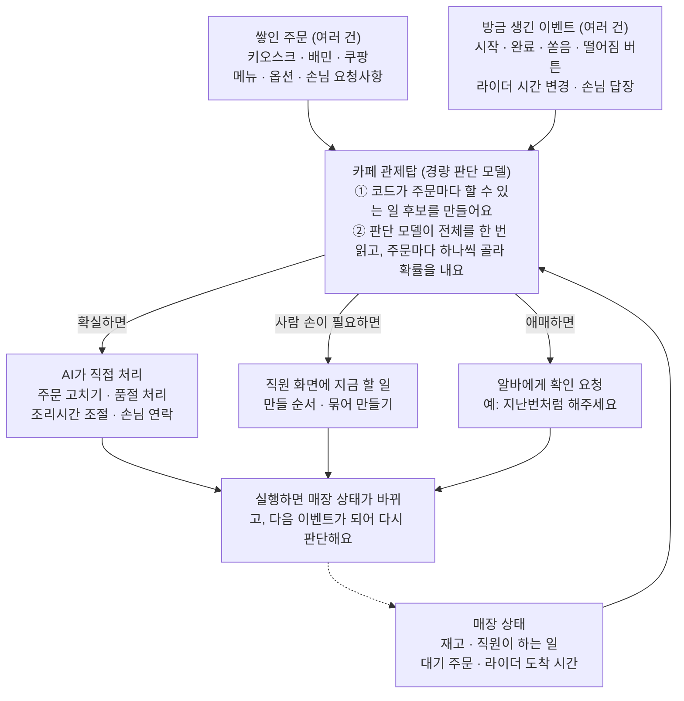

# 카페 관제탑 서비스 소개

작성일: 2026-11-19

## 어떤 서비스인가요

쌓인 주문을 한꺼번에 보고, 주문마다 **지금 할 일**을 정해 주는 카페 AI예요.

- **문제**: 피크 때 주문이 몰리면 요청사항을 놓치고, 재료가 모자라고, 뭘 먼저 할지 헷갈려요.
- **해결**: AI가 할 일을 정해요. 알바는 음료만 만들고, 주문 고치기·품절 처리·손님 연락은 AI가 해요.
- **설치**: 쓰던 키오스크와 직원 화면은 그대로예요. AI는 그 사이에서 판단만 해요.

## 동작하는 방법

주문이나 일이 생길 때마다 아래 3단계를 반복해요.

1. **넣는 것**: 쌓인 주문 여러 건 + 방금 생긴 일(완료, 쏟음, 재료 떨어짐) + 매장 상태
2. **판단**: AI가 전체를 한 번 보고, 주문마다 할 일 하나와 얼마나 확실한지를 정해요
3. **결과**: 확실하면 AI가 처리하고, 사람이 할 일은 직원 화면에 띄우고, 애매하면 알바에게 물어봐요

## 기능

기능은 6가지예요.

| 기능 | 예시 |
| --- | --- |
| 지금 할 일 알려주기 | 지은님, B1 아아 지금 시작하세요 |
| 묶어 만들기 | 매장 아아 2잔 + 배달 아아 1잔 같이 |
| 요청사항대로 주문 고치기 | 잘못 눌렀어요, 아이스로 → ICE로 변경 |
| 모자란 재료 나누기 | 오트 1잔분 → 꼭 오트여야 하는 손님에게 |
| 배달앱·손님 처리 | 품절 처리, 조리시간 늘리기, 손님에게 연락 |
| 애매하면 물어보기 | 지난번처럼 해주세요 → 알바에게 확인 |

## 예시: 오트밀크가 1잔분 남았을 때

오트밀크가 1잔분만 남았는데, 오트라떼 주문 3건이 같이 들어왔어요.

| 주문 | 손님 요청 | AI 결정 |
| --- | --- | --- |
| C1 오트라떼 | 오트 없으면 두유로 | 두유로 바꿔요 |
| C2 오트라떼 | 없음 | 손님에게 물어봐요 |
| B3 오트라떼 | 우유 못 먹어요, 꼭 오트로 | 마지막 오트로 만들어요 |

하나씩 따로 보면 먼저 온 C1이 오트를 가져가서, 우유를 못 먹는 B3는 만들 수 없어요. **한꺼번에 봐야 맞게 나눌 수 있어요.**

## 왜 경량 판단 모델인가요

- **규칙으로는 안 돼요**: 손님이 쓴 글은 키워드로 못 잡아요.
- **GPT는 위험해요**: 모르는 것도 자신 있게 처리하고, 가끔 늦어요.
- **판단 모델이 맞아요**: 할 수 있는 일 중에서만 고르고, 얼마나 확실한지 알려줘요. 그래서 혼자 할 일과 물어볼 일을 가를 수 있어요.

## 데모

진짜 POS에는 연결할 수 없어서, 가짜 키오스크·직원 화면·배달앱 세 화면을 만들고 그 사이에서 관제탑을 돌려요.

1. 심사위원이 QR로 이상한 요청사항을 넣어 주문해요.
2. AI가 실시간으로 할 일을 정하고, 주문을 고치고, 애매한 건 넘기는 모습을 보여줘요.
3. 요청사항 100개로 룰, GPT, 우리 모델을 비교한 그래프를 보여줘요. 알바에게 덜 넘기면서 덜 틀린다는 걸 증명해요.

먼저 확인할 것:

- [ ] 노트북에서 판단 모델이 0.3초 안에 답하는지
- [ ] 요청사항 100개에서 확률이 한국어로도 잘 맞는지
